

<!-- Hero Card -->

  

<!-- Three Linked Focus Tiles (32.5% width each) -->
<a href="https://github.com/SourasishG?tab=repositories&amp;q=&amp;type=source&amp;language=javascript"></a>
<a href="https://github.com/SourasishG/Pokemon-Atlas-3D"></a>
<a href="https://github.com/SourasishG/Web-Based-Office-Automation-Platform-With-AI-Chatbot"></a>

  

<!-- Monthly Contribution & Velocity Chart -->

  

<!-- Featured Repositories Stack -->
<a href="https://github.com/SourasishG/Web-Based-Office-Automation-Platform-With-AI-Chatbot">
  
</a>

  

<a href="https://github.com/SourasishG/Pokemon-Atlas-3D">
  
</a>

  

<a href="https://github.com/SourasishG/support-ticket-dashboard">
  
</a>

  

<a href="https://github.com/SourasishG/Face-Recognition-System">
  
</a>

  

<a href="https://github.com/SourasishG/Gradient-Descent-Visualizer">
  
</a>

  

<a href="https://github.com/SourasishG/orbital-music-app">
  
</a>

  

<!-- Yearly Contribution Calendar Heatmap -->

  

<!-- Dark Mode Contribution Snake Animation -->

  

<!-- Social Connect Badges -->

  

